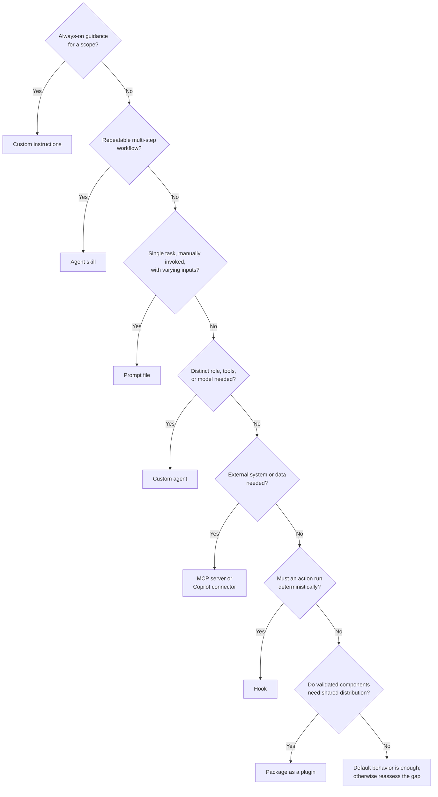

# When to create GitHub Copilot customization primitives

> Scope note: this document covers only the second half of the original research
> request — **when and how to create custom agents, skills, plugins, MCP servers,
> and custom instructions**. General "Software Factory" research (patterns,
> architecture, metrics) is covered in a sibling document and is intentionally
> not duplicated here.

Last verified against primary sources: 2026-10-31. GitHub's custom-agent surface
is explicitly in **public preview** for several IDEs (JetBrains, Eclipse, Xcode),
and the plugin/MCP ecosystem is actively evolving (the GitHub docs even carry
`utm_campaign=universe-2026` tags), so re-check the cited URLs before treating
exact field names or support-matrix cells as permanent.

---

## 1. The primitives, in one paragraph each

GitHub's own taxonomy (see §6) names **nine** customization primitives:
custom instructions, prompt files, custom agents, subagents, agent skills,
hooks, MCP servers, extensions, and plugins. The user's request asked about
five of these — custom agents, skills, plugins, MCP, and instructions — so
this document goes deep on those five and treats the rest (prompt files,
hooks, subagents, extensions) as supporting cast needed to make accurate
distinctions.

### Custom instructions
**What it is:** Persistent, always-on (or path-scoped) guidance that Copilot
folds into *every* applicable request — not a task Copilot chooses to run, but
background context it always has.
**Where it lives / how it loads:**
- Repo-wide: `.github/copilot-instructions.md` — applied to every request in
  the repo's context.
- Path-specific: one or more `NAME.instructions.md` files under
  `.github/instructions/` (can scope to a glob, e.g. only `.tsx` files). If a
  path matches both a path-specific file and the repo-wide file, **both** are
  used together.
- Agent instructions: one or more `AGENTS.md` files anywhere in the repo tree
  (nearest one wins); or a single `CLAUDE.md`/`GEMINI.md` at the repo root for
  those specific agents.
- Personal/org/enterprise instructions can also be set via GitHub.com UI.
[Source: docs.github.com — Adding repository custom instructions for GitHub Copilot](https://docs.github.com/en/copilot/how-tos/copilot-on-github/customize-copilot/add-custom-instructions/add-repository-instructions) · [Reference: Copilot customization cheat sheet](https://docs.github.com/en/copilot/reference/customization-cheat-sheet)

### Agent skills
**What it is:** A folder of instructions (plus optional scripts/templates)
that Copilot **loads on demand** when the task matches the skill's declared
purpose — not injected into every request, unlike instructions.
**Where it lives / how it loads:** A directory containing a `SKILL.md` file
with required YAML frontmatter `name` and `description`, optional `license`,
plus a Markdown body of steps/rules. Project skills: `.github/skills/<name>/`,
`.claude/skills/<name>/`, or `.agents/skills/<name>/`. Personal skills:
`~/.copilot/skills/<name>/` or `~/.agents/skills/<name>/`. Copilot
auto-discovers every file in the skill's directory once invoked, so scripts
placed alongside `SKILL.md` become available; an `allowed-tools` frontmatter
field can pre-approve specific tools (e.g. `shell`) so Copilot doesn't prompt
for confirmation each time — a deliberately risky setting, used only for
trusted scripts.
[Source: docs.github.com — Adding agent skills for GitHub Copilot](https://docs.github.com/en/copilot/how-tos/copilot-on-github/customize-copilot/customize-cloud-agent/add-skills) · [Concept: Agent skills](https://docs.github.com/en/copilot/concepts/customizations/agent-skills)

The **Agent Skills format itself is an open, cross-vendor standard**
([agentskills/agentskills](https://github.com/agentskills/agentskills)), also
implemented by Anthropic's Claude (`anthropics/skills`) and others — so a
well-written `SKILL.md` is portable beyond Copilot. Anthropic frames skills as
**progressive disclosure**: only the YAML frontmatter ("Level 1") is always
loaded for discovery; the full body and bundled files load only once the
skill is actually invoked, which is why skills don't bloat the context window
the way long-standing instructions can.
[Source: Anthropic — Agent Skills overview](https://platform.claude.com/docs/en/agents-and-tools/agent-skills/overview)

### Custom agents
**What it is:** A **reusable specialist persona** — instructions + a
restricted toolset + (optionally) a specific model and its own MCP servers —
that a user selects, or that another agent delegates to, instead of a
general-purpose agent for every task.
**Where it lives / how it loads:** A Markdown file with YAML frontmatter.
Per the GitHub reference: `.github/agents/AGENT-NAME.md` (repository-level),
`/agents/AGENT-NAME.md` in the org's `.github`/`.github-private` repo
(org-level), the enterprise `.github-private` repo (enterprise-level), or a
personal profile. VS Code uses the `*.agent.md` naming convention under
`.github/agents/`. Key frontmatter: `name`, `description` (required),
`target` (`vscode` | `github-copilot`, defaults to both), `tools`,
`model`, `disable-model-invocation` (replaces the retired `infer: false`),
`user-invocable`, `mcp-servers`, `metadata`. Body content is capped at
30,000 characters. The filename (minus extension) is the dedup key across
levels, so a repo-level agent can override an org-level agent of the same
name.
[Source: docs.github.com — Custom agents configuration](https://docs.github.com/en/copilot/reference/custom-agents-configuration) · [Concept: Custom agents](https://docs.github.com/en/copilot/concepts/customizations/custom-agents) · [VS Code — Custom agents](https://code.visualstudio.com/docs/agent-customization/custom-agents)

**Custom agent ≠ subagent.** This distinction is explicit and load-bearing in
GitHub's docs: *"A custom agent is a definition of a specialist. A subagent is
an agent doing delegated work in a separate context window."* You can run a
built-in agent (e.g. `explore`, `task`, `security-review`) as a subagent
without ever writing a custom-agent profile; conversely, selecting a custom
agent for your own session is not delegation at all. Separate context is a
property of delegation, not a reason by itself to author a profile.
[Source: docs.github.com — Custom agents](https://docs.github.com/en/copilot/concepts/customizations/custom-agents)

### MCP servers
**What it is:** An external **capability provider** reached over the open
Model Context Protocol (MCP) — "a standardized way to connect AI applications
to external systems," analogous to a USB-C port. An MCP server exposes tools
(and optionally resources/prompts) that Copilot can call once connected,
giving it access to systems the repo itself knows nothing about (ticketing
systems, calendars, databases, documentation search).
**Where it lives / how it loads:** Configuration is surface-specific —
`mcp.json` (path varies by IDE/CLI), repository-level MCP settings on
GitHub.com (used by Copilot cloud agent and Copilot code review), or an
`mcp-servers` property embedded directly in a custom-agent profile so that
*only that agent* gets the connection. GitHub also offers managed **Copilot
connectors** as a lower-friction alternative to self-hosting/self-configuring
an MCP server for popular services.
[Source: Model Context Protocol — What is MCP?](https://modelcontextprotocol.io/introduction) · [docs.github.com — Customization cheat sheet (MCP row)](https://docs.github.com/en/copilot/reference/customization-cheat-sheet)

### Plugins
**What it is:** A **packaging and distribution mechanism** — not a new
capability of its own, but a way to bundle and install several of the above
primitives (skills, custom agents, hooks, MCP server configs, LSP configs,
surface-specific extension code) together, discoverable through a
**marketplace** catalog.
**Where it lives / how it loads:** A plugin is a directory with a
`plugin.json` manifest at its root (Agent Plugins 1.0) containing, optionally,
`skills/`, `mcp.json`, and a `com.github.copilot/` subtree for
Copilot-specific components (`agents/`, `commands/`, `rules/`, `hooks/`,
`lsp.json`) that other clients ignore. A **legacy Copilot CLI format** also
exists (manifest without the Agent Plugins schema) with a different layout
(`agents/`, `skills/`, `hooks.json`, `.mcp.json` all at plugin root) — GitHub
recommends Agent Plugins 1.0 for new plugins unless you need configurable
component paths. A **marketplace** is simply a repository (or other Git host,
or local directory) containing `.github/plugin/marketplace.json`, which lists
plugin entries (`name`, `description`, `version`, `source`). The Universe '26
sample repo demonstrates the minimal case: a one-plugin marketplace whose
`source` points at the repo's own `.github/skills/universe-cheatsheet`
directory (see §4).
[Source: docs.github.com — Plugins for GitHub Copilot](https://docs.github.com/en/copilot/concepts/customizations/plugins) · [Creating and sharing a plugin marketplace on GitHub](https://docs.github.com/en/copilot/how-tos/copilot-on-github/customize-copilot/create-and-share-plugin-marketplaces)

### Supporting primitives (needed for accurate contrast)
- **Prompt files** (`.github/prompts/*.prompt.md`): a reusable, manually
  invoked prompt template with input variables — for a task you run
  repeatedly with different inputs, not one Copilot decides to use on its
  own. Narrower than a skill (no bundled scripts/resources, no automatic
  discovery).
- **Hooks** (`.github/hooks/*.json`): shell commands that run
  **deterministically** at defined lifecycle events (before a tool runs, at
  session end, etc.) — the only primitive here that executes outside the
  model's judgment, which is why GitHub's docs stress "neither [instructions
  nor hooks] alone establishes a security boundary" on their own, but hooks
  are the one mechanism that can enforce one.
- **Subagents**: a runtime behavior (delegated work in an isolated context),
  not a file you author. A subagent can run a built-in agent or a custom
  agent profile.
- **Extensions**: capabilities "implemented in code" — a Copilot CLI
  extension is a JavaScript module adding tools/slash-commands/session-aware
  state; distinct from legacy GitHub App-based "Copilot Extensions" and from
  IDE extensions. The Universe repo's `.github/extensions/*` canvases
  (`universe-welcome`, `universe-cheatsheet-artifact`, `badge-simulator`) are
  concrete examples — see §4.
[Source: docs.github.com — Comparing Copilot customization features](https://docs.github.com/en/copilot/concepts/customizations/comparing-customizations) · [Reference: Customization cheat sheet](https://docs.github.com/en/copilot/reference/customization-cheat-sheet)

---

## 2. Decision guide: which primitive, and why

Ask these questions, roughly in order (adapted from GitHub's and VS Code's own
decision framing):

1. **Does this need to apply to every request in some scope, with no explicit
   invocation?** → **Custom instructions**. If it only matters for certain
   files/languages, scope it as path-specific instructions rather than
   polluting the repo-wide file.
2. **Is this a repeatable multi-step workflow that should load only when
   relevant, possibly bundling a script or template?** → **Agent skill**.
   If it's a single task you invoke yourself with varying inputs and no
   bundled resources, a **prompt file** is lighter-weight.
3. **Do you need a specialist persona — a distinct role, restricted toolset,
   or a different model — that you (or another agent) explicitly select or
   delegate to?** → **Custom agent**. Don't reach for this just to get
   separate context; that's a property of running *any* agent as a
   **subagent**, custom or built-in.
4. **Does Copilot need to reach a system or data source outside the repo and
   its built-in tools?** → **MCP server** (or a managed **Copilot connector**
   if one exists for that service). Check built-in tools first — GitHub's own
   guidance is explicit: "Before adding an integration, check whether the
   agent's existing tools already meet your needs."
5. **Do you have several of the above that are always used together and
   should be installed/maintained as one unit, possibly shared outside your
   repo?** → **Plugin**, published via a **marketplace**. A plugin is never
   the first thing you build — author the skill/agent/MCP config
   independently first, then package.
6. **Does an action need to run with certainty, independent of whether the
   model "decides" to do it** (e.g., always run a formatter after an edit,
   always block pushes to a protected path)? → **Hook**. This is the one case
   none of the model-driven primitives above can satisfy, because instructions
   and skills are suggestions to the model, not guarantees.
7. **Do you need new tool-calling capability implemented in code (stateful
   across a session, a new slash command backed by logic)** rather than
   reachable via an existing MCP server? → **Extension**.

VS Code's own framing adds a useful discipline check before step 1: *"Start
from an observed problem instead of adding customization by default. Define a
representative task and its expected outcome. If the result already meets
your needs, stop."* Treat every primitive below as something you reach for
only after you've watched the default agent fail the same way twice.
[Source: VS Code — Understand agent customization](https://code.visualstudio.com/docs/agents/concepts/customization)

### Anti-patterns to watch for
- **Using instructions for a one-off or task-specific process.** GitHub's own
  "when shouldn't you" guidance for instructions: *"You only want the
  behavior for one kind of task. Use a skill instead."* A bloated
  `copilot-instructions.md` with narrow, rarely-relevant procedures wastes
  context on every single request, forever.
- **Writing a custom agent instead of a skill.** If all you need is
  task-specific instructions and resources — no distinct toolset, no
  persona switch — a skill is simpler and is loaded only when relevant.
- **Reaching for an MCP server before checking built-in tools**, or before
  checking whether a managed **Copilot connector** already covers the
  service — self-hosting/maintaining an MCP server is ongoing operational
  burden a connector may remove.
- **Building a plugin as your first customization.** Plugins only solve a
  packaging/distribution problem for things that already work independently.
  A one-plugin marketplace wrapping a single skill (as in the Universe repo,
  §4) is a reasonable *minimal* example, but don't add the marketplace
  machinery until you actually need to distribute.
- **Treating instructions or skills as enforcement.** Both are prompts to a
  model — "Instructions guide the model, but do not guarantee that it will
  follow every rule." If an action must always happen (never leak a secret,
  always run a linter), that is a **hook**'s job, not an instructions rule.
- **Pre-approving `shell`/`bash` in a skill's `allowed-tools` without full
  trust in the skill and every script it references.** GitHub flags this
  explicitly as removing a confirmation safety step.
- **Confusing "select a custom agent for my session" with "delegate to a
  subagent."** They are different usage modes of the same profile; conflating
  them leads to either over-authoring profiles that are never delegated to,
  or assuming separate context requires a bespoke persona when a built-in
  subagent (`explore`, `task`, `research`, etc.) would do.
- **Skipping the IDE/surface support matrix.** Custom agents are public
  preview on JetBrains/Eclipse/Xcode; hooks are unsupported on most non-VS
  Code/CLI surfaces; prompt files don't exist on GitHub.com or Copilot CLI at
  all. Designing a customization around a surface that doesn't support it is
  a dead end — check the matrix in §5 first.

---

## 3. Comparison table

| Primitive | Activation | Granularity | File / location | Portable format? | Primary use case |
|---|---|---|---|---|---|
| **Custom instructions** | Automatic, every matching request | Repo-wide or path-scoped | `.github/copilot-instructions.md`, `.github/instructions/*.instructions.md`, `AGENTS.md` | `AGENTS.md` is a cross-vendor convention (agentsmd/agents.md) | Coding standards, conventions, always-true context |
| **Prompt files** | Manual (slash command / picker) | Single task, parameterized | `.github/prompts/*.prompt.md` | Copilot/VS Code specific | Repeatable one-off task with varying inputs |
| **Agent skills** | Automatic when task matches description, or invoked directly (e.g. `/skill-name`) | Multi-step workflow + bundled resources | `.github/skills/<name>/SKILL.md` (+ `.claude/skills`, `.agents/skills`, `~/.copilot/skills`) | **Yes** — open Agent Skills spec, used by Copilot, Claude, others | Standardized, repeatable workflow with templates/scripts |
| **Custom agents** | Manual select, or delegated to as a subagent | Specialist role: instructions + tools + model | `.github/agents/*.agent.md` (repo), org/enterprise `.github-private` repos, personal | Format shared by Copilot (VS Code, CLI, cloud, IDEs); not shared with Claude | Specialized persona with a restricted/different toolset |
| **Subagents** | Automatic delegation by main agent, or explicit reference | Runtime isolation, not a file | N/A — runtime process | N/A | Isolate a subtask's context; parallelize independent work |
| **MCP servers** | Automatic (model calls a tool) or explicit "use tool X" | External system integration | `mcp.json` (path varies), repo MCP settings, or `mcp-servers` in an agent profile | **Yes** — open protocol, broad client support (Claude, ChatGPT, VS Code, Cursor, etc.) | Reach data/actions outside the repo and built-in tools |
| **Hooks** | Automatic at a defined lifecycle event, guaranteed | Deterministic shell command | `.github/hooks/*.json` | Copilot/VS Code specific | Enforcement, logging, validation independent of model choice |
| **Extensions** | Loaded with the session; adds tools/commands | Code-level capability | Copilot CLI: JS module; Copilot App: `.github/extensions/<name>/extension.mjs` | Copilot-specific | Stateful custom tools/slash-commands beyond MCP's reach |
| **Plugins** | Installed once via a marketplace; bundled components follow their own activation rules | Packaging of multiple primitives | `plugin.json` + component subdirs; cataloged by `.github/plugin/marketplace.json` | Agent Plugins 1.0 is a shared schema across compatible surfaces (with a Copilot-only `com.github.copilot/` subtree); legacy Copilot CLI format also exists | Distribute/install a related set of customizations together |

[Sources: docs.github.com — Customization cheat sheet (feature overview, usage comparison, IDE/surface support tables)](https://docs.github.com/en/copilot/reference/customization-cheat-sheet) · [Comparing Copilot customization features](https://docs.github.com/en/copilot/concepts/customizations/comparing-customizations) · [VS Code — Customization options at a glance](https://code.visualstudio.com/docs/agents/concepts/customization)

### IDE / surface support snapshot (✓ = supported, P = preview, ✗ = not supported)

| Feature | VS Code | Visual Studio | JetBrains | Eclipse | Xcode | GitHub.com | Copilot CLI |
|---|:---:|:---:|:---:|:---:|:---:|:---:|:---:|
| Custom instructions | ✓ | ✓ | P | P | P | ✓ | ✓ |
| Prompt files | ✓ | ✓ | P | ✗ | P | ✗ | ✗ |
| Custom agents | ✓ | ✓ | P | P | P | ✓ | ✓ |
| Subagents | ✓ | ✗ | P | P | P | ✗ | ✓ |
| Agent skills | ✓ | ✓ | P | ✗ | ✗ | ✓ | ✓ |
| Hooks | P | ✗ | ✗ | ✗ | ✗ | ✓ | ✓ |
| MCP servers | ✓ | ✓ | ✓ | ✓ | ✓ | ✓ | ✓ |

[Source: docs.github.com — Customization cheat sheet, "IDE and surface support"](https://docs.github.com/en/copilot/reference/customization-cheat-sheet) (verify current status before relying on any single cell — this table is explicitly subject to change and several rows are marked preview)

---

## 4. Mermaid decision flowchart



---

## 5. How the primitives compose in an agentic software factory

A factory-style setup — many repos, many automated runs, humans reviewing
output rather than writing it — tends to use these primitives in layers,
each narrowing scope as you go deeper:

1. **Custom instructions** set the floor: build/test commands, branch and PR
   conventions, "never merge without review," security posture. These apply
   whether a human or an automation triggers the session.
2. **MCP servers / connectors** extend what any agent in the factory can
   reach — issue trackers, documentation search, internal APIs — so skills
   and agents don't need to reinvent access to those systems.
3. **Agent skills** encode the factory's repeatable *production steps* —
   "turn an issue into a draft PR," "run a security review and fold findings
   back into the workflow," "file a themed artifact." Skills are what make a
   factory's output consistent run-to-run instead of depending on how a
   particular session happened to be prompted.
4. **Custom agents** encode specialist *roles* the factory delegates to for a
   bounded sub-task — a review agent restricted to read-only tools, a
   documentation specialist with a narrower toolset than the main agent. The
   factory's main agent runs these as subagents so their intermediate work
   never bloats the primary conversation.
5. **Hooks** are the factory's deterministic guardrails — the places where
   "the model decided to do the safe thing" isn't good enough and something
   must run every time (formatting, secret scanning, blocking a protected
   path) regardless of what any skill or instruction says.
6. **Plugins + a marketplace** are how a factory *distributes* a validated
   bundle of the above (a skill + its MCP config + a supporting custom agent)
   to many repositories or teams at once, instead of each repo reinventing
   the same skill independently.

The net effect: instructions and skills shape what the model *decides* to do;
MCP/connectors and extensions expand what it's *capable* of doing; custom
agents and subagents control *who* (which persona, in which context) does a
given piece of work; hooks are the only layer that acts *regardless* of the
model's decision; and plugins are purely about *shipping* a working
combination of the rest at scale.

---

## 6. Concrete examples from the GitHub Universe '26 virtual workshop

All examples below are drawn directly from the local read-only checkout at
`octodemo/virtual-universe-26` (not modified by this research).

### Custom instructions in practice
`.github/copilot-instructions.md` in the Universe repo is a long, scenario-
specific instruction set for the workshop's guided tutorial flow: when to open
the welcome canvas, how to verify a learner's fork before pushing, exact `gh`
commands for a scripted "cheat sheet issue" exercise, and explicit prohibitions
("Never merge on the learner's behalf," "Use synthetic examples... discard
unrelated changes, or use destructive cleanup commands"). This illustrates the
*repo-wide, always-on* nature of the primitive — these rules apply to every
session in that repo, which is also why the file reads as unusually detailed:
anything narrower belongs in a skill instead (see the anti-pattern in §2).

### Agent skill in practice
`.github/skills/issue-to-pr/SKILL.md` is a clean, minimal example of the
primitive as documented: YAML frontmatter with `name: issue-to-pr` and a
`description` ("Read an open issue, propose a fix, and open a draft pull
request for review. Use when asked to turn an issue into a suggested fix or
pull request."), then a numbered procedure (confirm fork target → pick issue →
branch → smallest fix → **review for security** → open draft PR) plus a
`## Rules` section ("Never merge, approve, or close anything... If the fix is
unclear, comment on the issue with your questions instead of guessing."). The
companion skills guide shows the skill being *edited twice* over the course of
the tutorial — once to require a "How to test" section in the PR body, once to
insert a mandatory security-review step before the PR is opened — demonstrating
a skill as a living, versioned workflow definition rather than a one-shot
script.
[`02-github-copilot-latest-features/skills/README.md`](https://github.com/octodemo/virtual-universe-26/blob/main/02-github-copilot-latest-features/skills/README.md) ·
[`02-github-copilot-latest-features/security-review/README.md`](https://github.com/octodemo/virtual-universe-26/blob/main/02-github-copilot-latest-features/security-review/README.md)

Two more skills in the same repo (`.github/skills/cheatsheet-artifact/SKILL.md`,
`.github/skills/universe-cheatsheet/SKILL.md`) show a nuance worth noting: both
explicitly call out that a *built-in tool* (`/create-issue-artifact`) is the
"real work" choice, and that the custom skill exists only to route around a
workshop-specific constraint (keeping everything in one session instead of
requiring a second session linked to the new issue). This is a good worked
example of the anti-pattern "don't build a custom primitive when the built-in
capability already does the job" — the skill's own doc comment says so
explicitly: *"That is the built-in tool, and it is the one to reach for in
real work."*

### Custom agent and security-review reference in practice
The Security Review guide includes a collapsed example custom-agent profile
in YAML (`name`, `displayName`, `description`, `tools: ["*"]`, and a `prompt`
with an explicit false-positive-minimization and impact-focus policy) —
functionally identical in spirit to the `.agent.md` frontmatter documented by
GitHub/VS Code, scoping a specialist persona (a high-confidence,
low-noise security reviewer) distinct from the general agent.
[`02-github-copilot-latest-features/security-review/README.md`](https://github.com/octodemo/virtual-universe-26/blob/main/02-github-copilot-latest-features/security-review/README.md)

The Tools-and-connectors guide also demonstrates *discovering* an
already-published custom agent rather than writing one from scratch: it
directs the learner to use `/agentfinder` to locate the "Context7 Expert"
custom agent in `github/awesome-copilot`
(`agents/context7.agent.md`), review its source for compatibility, and only
then add both the agent and its paired Context7 MCP connector —
underscoring that a custom agent is frequently a shared/distributed asset,
not something every repo authors independently.
[`02-github-copilot-latest-features/tools-and-connectors/README.md`](https://github.com/octodemo/virtual-universe-26/blob/main/02-github-copilot-latest-features/tools-and-connectors/README.md)

### MCP in practice
The same Tools-and-connectors guide is the repo's clearest MCP example: it has
the learner add the remote Context7 MCP server (`https://mcp.context7.com/mcp`,
no API key) via the Copilot app's **Customize → search → Add server → HTTP**
flow, restricts what may be sent to it ("Send only public documentation
queries, not repository contents"), and then has the learner wire it into the
`issue-to-pr` skill with explicit failure-handling language ("report
unavailable tools instead of pretending a lookup succeeded"). Notably, no MCP
config file is committed to the repo for this — connection was done through
the UI, consistent with GitHub's documented "repository MCP settings on
GitHub" and surface-specific `mcp.json` paths rather than one universal file.

### Plugin / marketplace in practice
`.github/plugin/marketplace.json` and `.github/plugin/plugin.json` together
form a **minimal, real one-plugin marketplace**:
```json
// .github/plugin/marketplace.json
{
  "name": "virtual-universe-26",
  "owner": { "name": "octodemo", "url": "https://github.com/octodemo" },
  "metadata": { "description": "Skills from the GitHub Virtual Universe '26 workshop.", "version": "1.0.0" },
  "plugins": [
    {
      "name": "universe-cheatsheet",
      "description": "Make a themed GitHub Universe '26 cheat sheet and file it as issue artifacts.",
      "version": "1.0.0",
      "source": "./",
      "skills": [".github/skills/universe-cheatsheet"]
    }
  ]
}
```
This matches the documented schema exactly (`owner`, `metadata.description`,
`metadata.version`, `plugins[].source`) and shows the simplest possible case:
a plugin whose only bundled component is a single skill directory, sourced
from the repo's own working tree (`"source": "./"`) rather than an external
path.
[`.github/plugin/marketplace.json`](https://github.com/octodemo/virtual-universe-26/blob/main/.github/plugin/marketplace.json) ·
[`.github/plugin/plugin.json`](https://github.com/octodemo/virtual-universe-26/blob/main/.github/plugin/plugin.json)

### Extensions in practice (for contrast with skills/plugins)
`.github/extensions/{universe-welcome,universe-cheatsheet-artifact,badge-simulator}`
are Copilot App **extensions** (`extension.mjs` modules using
`@github/copilot-sdk/extension`'s `joinSession`/`createCanvas`), not skills or
plugins — they implement a stateful HTTP-served canvas UI, run `gh` CLI
commands directly from JS (fork detection, issue creation, state caching to
`${COPILOT_HOME}/cache/...`), and persist session-scoped state across turns.
This is the concrete illustration of "capabilities implemented in code" from
GitHub's definition of extensions — well beyond what instructions or a
skill's Markdown body could do on their own.
[`.github/extensions/universe-welcome/extension.mjs:1-60`](https://github.com/octodemo/virtual-universe-26/blob/main/.github/extensions/universe-welcome/extension.mjs#L1-L60) ·
[`.github/extensions/universe-cheatsheet-artifact/extension.mjs:1-60`](https://github.com/octodemo/virtual-universe-26/blob/main/.github/extensions/universe-cheatsheet-artifact/extension.mjs#L1-L60)

### Hooks and automations — not primitives this repo authors directly, but adjacent
The Universe repo doesn't commit a `.github/hooks/*.json` hook file, but its
"Automate" guide shows the related **Automation** surface (a saved agent task
triggered manually/on schedule/on event) wrapping the `issue-to-pr` skill —
useful to distinguish from a hook: an Automation is "run this whole
agent task on a trigger," while a hook is "run this shell command at a
lifecycle point inside an agent's run." The guide also explicitly warns not to
assume `/security-review` can simply be invoked unchanged *inside* a GitHub
Actions-based agentic workflow without validating its authentication — a
reminder that primitives don't automatically transfer between surfaces.
[`02-github-copilot-latest-features/automate/README.md`](https://github.com/octodemo/virtual-universe-26/blob/main/02-github-copilot-latest-features/automate/README.md) ·
[`01-github-latest-features/create-your-first-agentic-workflow/README.md`](https://github.com/octodemo/virtual-universe-26/blob/main/01-github-latest-features/create-your-first-agentic-workflow/README.md)

---

## 7. Full citation list

**GitHub Docs (docs.github.com), fetched 2026-10-31:**
- [Comparing Copilot customization features](https://docs.github.com/en/copilot/concepts/customizations/comparing-customizations) — the primary decision-framing source for this document.
- [Copilot customization cheat sheet](https://docs.github.com/en/copilot/reference/customization-cheat-sheet) — feature overview table, usage-comparison table, IDE/surface support matrix.
- [Custom agents (concept)](https://docs.github.com/en/copilot/concepts/customizations/custom-agents)
- [Custom agents configuration (reference)](https://docs.github.com/en/copilot/reference/custom-agents-configuration)
- [Agent skills (concept)](https://docs.github.com/en/copilot/concepts/customizations/agent-skills)
- [Adding agent skills for GitHub Copilot (how-to)](https://docs.github.com/en/copilot/how-tos/copilot-on-github/customize-copilot/customize-cloud-agent/add-skills)
- [Plugins for GitHub Copilot (concept)](https://docs.github.com/en/copilot/concepts/customizations/plugins)
- [Creating and sharing a plugin marketplace on GitHub (how-to)](https://docs.github.com/en/copilot/how-tos/copilot-on-github/customize-copilot/create-and-share-plugin-marketplaces)
- [Adding repository custom instructions for GitHub Copilot (how-to)](https://docs.github.com/en/copilot/how-tos/copilot-on-github/customize-copilot/add-custom-instructions/add-repository-instructions)

**VS Code docs (code.visualstudio.com), fetched 2026-10-31:**
- [Understand agent customization](https://code.visualstudio.com/docs/agents/concepts/customization) — "customization options at a glance" decision table.
- [Custom agents in VS Code](https://code.visualstudio.com/docs/agent-customization/custom-agents)

**Model Context Protocol:**
- [What is MCP? — modelcontextprotocol.io](https://modelcontextprotocol.io/introduction)

**Anthropic:**
- [Agent Skills overview — platform.claude.com](https://platform.claude.com/docs/en/agents-and-tools/agent-skills/overview)

**Local primary source — octodemo/virtual-universe-26 (read-only checkout at `/Users/matthew_hui/.copilot/repos/virtual-universe-26`, not modified):**
- `.github/copilot-instructions.md`
- `.github/skills/issue-to-pr/SKILL.md`
- `.github/skills/cheatsheet-artifact/SKILL.md`
- `.github/skills/universe-cheatsheet/SKILL.md`
- `.github/plugin/plugin.json`, `.github/plugin/marketplace.json`
- `.github/extensions/universe-welcome/extension.mjs`
- `.github/extensions/universe-cheatsheet-artifact/extension.mjs`
- `02-github-copilot-latest-features/{skills,tools-and-connectors,security-review,automate}/README.md`
- `01-github-latest-features/create-your-first-agentic-workflow/README.md`
- `README.md` (repo root)

## 8. Known gaps / uncertainty

- **Hooks**: covered here only through secondary citation of the comparison
  docs; this research did not fetch GitHub's dedicated `hooks-reference` page
  or find a committed `.github/hooks/*.json` example in the Universe repo to
  verify the exact JSON schema. Treat the hooks section as directionally
  correct but not schema-verified.
- **Agent Plugins 1.0 full field reference** (`cli-plugin-reference`) was not
  fetched in full; the plugin section above relies on the concept page's
  directory-structure example rather than the exhaustive manifest-field table.
- **Preview status is a moving target.** Several cells in the support matrix
  (custom agents on JetBrains/Eclipse/Xcode; hooks on VS Code) are marked
  public preview as of this writing and are the most likely facts in this
  document to be stale by the time it's read — re-check
  [the cheat sheet](https://docs.github.com/en/copilot/reference/customization-cheat-sheet)
  and [feature matrix](https://docs.github.com/en/copilot/reference/copilot-feature-matrix)
  before relying on a specific surface/feature combination.
- The Universe repo demonstrates custom instructions, skills, plugins,
  extensions, and MCP connector usage concretely, but does **not** contain a
  committed custom-agent profile file (`*.agent.md`) of its own — its one
  custom-agent example (the security-review agent, and the externally
  referenced Context7 Expert agent) is either inline in a guide's Markdown or
  sourced from a different repo (`github/awesome-copilot`), not authored in
  this checkout. Treat the custom-agent example in §6 as illustrative of the
  *format*, not as an in-repo artifact you can re-read directly.
